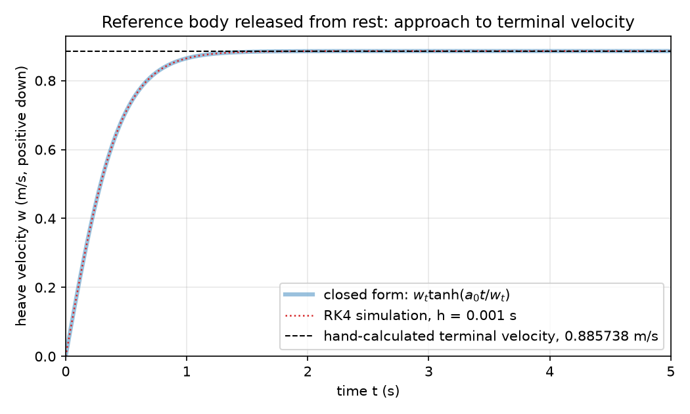

# M0 technical note: vertical motion under weight, buoyancy and drag

Milestone M0 of the [ROV simulator design](../superpowers/specs/2026-11-05-rov-simulator-design.md). Code: `src/rovsim/sim/vertical.py` and `src/rovsim/sim/integrate.py`. Figure and numbers reproduced by `scripts/plot_m0.py`.

**What this note claims.** A hand-written RK4 integrator, applied to a one-degree-of-freedom heave model, reproduces the hand-calculated terminal velocity and the exact closed-form transient to better than 1 part in 10^9, and its error falls with step size at the rate fourth-order theory predicts. **What it does not claim.** The body used throughout (10 kg, 8 L, Cd = 1.0, A = 0.05 m^2) is a declared placeholder chosen so the arithmetic can be done by hand. It is not Approach A's geometry, and nothing here predicts how the real vehicle behaves. M0 validates the model and the integrator, not the vehicle.

## 1. What is being modelled

A rigid body moving only vertically in still fresh water (rho = 1000 kg/m^3; the target site is a Florida sinkhole, not the sea). The coordinate z is positive **down**, following the SNAME body-fixed convention, so the heave velocity w = dz/dt is positive when the body sinks and negative when it rises.

Newton's second law along z:

    m * dw/dt = (m - rho*V) * g  -  0.5 * rho * Cd * A * w * |w|

- `(m - rho*V) * g` is weight minus buoyancy, called F below. It is positive (downward) when the body is heavier than the water it displaces. Gravity is the standard 9.80665 m/s^2.
- The drag term is quadratic. It is written `w*|w|` rather than `w^2` so that it always opposes the motion: for a rising body (w < 0) it pushes down.
- Define `k = 0.5 * rho * Cd * A`, with units N s^2/m^2.

For the reference body: F = (10 - 1000 x 0.008) x 9.80665 = 19.6133 N downward, and k = 0.5 x 1000 x 1.0 x 0.05 = 25.0 N s^2/m^2.

## 2. Derivations

### Terminal velocity

At terminal velocity dw/dt = 0, so the net static force balances drag. For a sinking body (F > 0, w > 0):

    F = k * w_t^2    =>    w_t = sqrt(F / k)

In general `w_t = sign(F) * sqrt(|F| / k)`. For the reference body:

    w_t = sqrt(19.6133 / 25.0) = sqrt(0.784532) = 0.885738 m/s

Two limiting cases are handled explicitly rather than left to floating-point accident. If F = 0 (neutral buoyancy) the body never moves and w_t = 0. If Cd * A = 0 (no drag) nothing ever balances F, and w_t is +inf or -inf by the sign of F.

### The transient

For release from rest with F > 0, w >= 0 throughout, so |w| = w and

    m * dw/dt = F - k * w^2.

Write a0 = F/m (the initial acceleration) and substitute k = F / w_t^2:

    dw/dt = a0 * (1 - w^2 / w_t^2).

Separate variables and integrate from w = 0 at t = 0:

    integral dw / (1 - w^2/w_t^2) = a0 * t
    w_t * artanh(w / w_t) = a0 * t

    w(t) = w_t * tanh(a0 * t / w_t)

Integrating once more, using the identity integral tanh(u) du = ln cosh(u):

    z(t) = (w_t^2 / a0) * ln cosh(a0 * t / w_t)

Check: dz/dt = (w_t^2/a0) * (a0/w_t) * tanh(a0 t / w_t) = w_t * tanh(a0 t / w_t) = w(t), so the pair closes. Initial conditions z(0) = w(0) = 0 hold. The time constant is `tau = w_t / a0 = m * w_t / F`, which is 0.451601 s for the reference body, so a 5 s run is about 11 tau and the velocity has settled to within the integrator's error.

One implementation detail matters for anyone reusing the closed form. `cosh` overflows a double for arguments above about 710, so evaluating `ln cosh x` literally returns `inf` beyond roughly 320 s on this body. The code uses the algebraically identical `ln cosh x = logaddexp(x, -x) - ln 2`, which stays finite for any x. The two agree to 1.8e-15 over the range tested, so none of the numbers below depend on the choice. (This bug was found by a reviewer, not by a test; see the [AI-assistance log](../ai-assistance-log.md), entry 3.)

## 3. What is deliberately not modelled yet

| Omission | Effect on the answer | Direction | Planned |
|---|---|---|---|
| **Added mass** (the water the body must accelerate along with itself) | Raises the effective inertia from m to m + m_a. The terminal velocity is unchanged, because at constant velocity nothing is accelerating. The transient is slower in reality. | This model reaches terminal velocity **too quickly**: tau is underestimated. | M2 |
| **Tether** | Adds drag along its length and a weight or buoyancy force that depends on its construction. | Tether drag lowers the true terminal velocity, so this model **overestimates speed**. The sign of the static effect depends on whether the tether is net heavy or net buoyant, and is not asserted here. | After M2 |
| **Thrusters** | No propulsive force is present, so only passive sink or rise is described. | Not a bias for a free release. With thrust applied, the equilibrium speed changes and this model does not describe it. | M1 |
| **Other degrees of freedom** | No surge, sway, pitch, roll or yaw, and so no coupling between them. | Cannot be bounded from a 1-DOF model. | M2 onward |

Drag is also taken as a constant Cd with a single reference area. Real Cd varies with Reynolds number and with the body's attitude.

## 4. Validation method

Three independent checks, each against something other than the code under test.

1. **Terminal velocity against a hand calculation.** The value in section 2, worked on paper from the force balance, is compared with the closed-form function and with the simulated velocity at the end of the run.
2. **Whole-trajectory comparison against the exact solution.** The RK4 trajectory from rest is compared with the `tanh` and `ln cosh` expressions at every step. This tests the transient, not just the end state.
3. **Step-size convergence.** If the integrator is fourth-order, halving h should cut the error by about 2^4 = 16. The error at t = 5 s was measured at h = 0.1, 0.05 and 0.025 s.

The integrator itself is a hand-written classical RK4 with fixed step, deliberately not `scipy.integrate.solve_ivp`: a fixed step is what makes check 3 meaningful, whereas an adaptive solver chooses and hides its own step. The four stages evaluate the derivative at t, t + h/2, t + h/2 and t + h with weights (1, 2, 2, 1)/6. A dedicated test integrates `dy/dt = t^3` over [0, 1], which RK4 solves exactly because its weights reduce to Simpson's rule; the answer must be 0.25 to about 1e-12, and that test fails if any stage time is wrong. The suite is 39 tests and runs clean under `pytest -W error`.

## 5. Figure

*Figure 1. Reference body released from rest. The RK4 curve (dotted) lies on top of the closed form (wide, translucent) at the scale of the plot, and both approach the dashed hand-calculated terminal velocity of 0.885738 m/s. Regenerate with `.venv/bin/python scripts/plot_m0.py`.*

The figure shows agreement only at plot resolution. The quantitative comparison is in the table below.

## 6. Results

Reference body, fresh water, release from rest, RK4 with h = 1e-3 s, run to t = 5 s.

| Quantity | Value |
|---|---|
| Net static force F | 19.6133 N downward |
| Drag group k | 25.0 N s^2/m^2 |
| Terminal velocity, hand-calculated | 0.885738 m/s |
| Terminal velocity, closed form | 0.8857381103 m/s |
| Simulated w at t = 5 s | 0.8857381099 m/s |
| Relative error, simulated vs closed form | 4.8e-10 |
| Relative error, simulated vs hand calculation | 1.2e-7 |
| Max deviation of trajectory from closed form | 1.2e-13 m in z, 3.1e-13 m/s in w |
| Depth at t = 5 s | 4.151432 m |
| Time constant tau | 0.451601 s |

The 1.2e-7 against the hand calculation is the six-figure rounding of the hand value, not integrator error; the integrator agrees with the closed form to 4.8e-10.

Step-size study, error at t = 5 s:

| h (s) | Error | Ratio to previous |
|---|---|---|
| 0.1 | 3.91e-5 | |
| 0.05 | 2.18e-6 | 18.0 |
| 0.025 | 1.29e-7 | 16.9 |

Ratios of 18.0 and 16.9 against a theoretical 16 confirm fourth-order convergence. The ratio approaches 16 from above as h shrinks, as expected when higher-order error terms are still contributing at the larger steps.

Limits of this validation: one body, one release condition (from rest, sinking), one fluid. Rising bodies are covered by the sign convention and unit tests but not by a plotted trajectory.

## 7. What M1 needs from M0

- **A derivative function the thrusters can add to.** `derivative(body)` returns `f(t, y)` for state `[z, w]`. M1 adds thrust as a force on the right-hand side, and thrust commands vary with time, so the time argument that M0 currently ignores will start to matter. This is why the `t^3` stage-time test exists.
- **A trusted integrator.** M1 can attribute a discrepancy to the thruster model rather than the integrator, because the integrator now has a convergence record and an exactness test.
- **The sign convention.** z positive down. Thruster force vectors in M1 must be written in the same frame.
- **A known placeholder.** The reference body must be replaced by Approach A's real mass, volume and drag coefficients before any result is read as a statement about the vehicle. Those inputs are not available yet: there is no hull geometry, and the design speed is still TBD.
